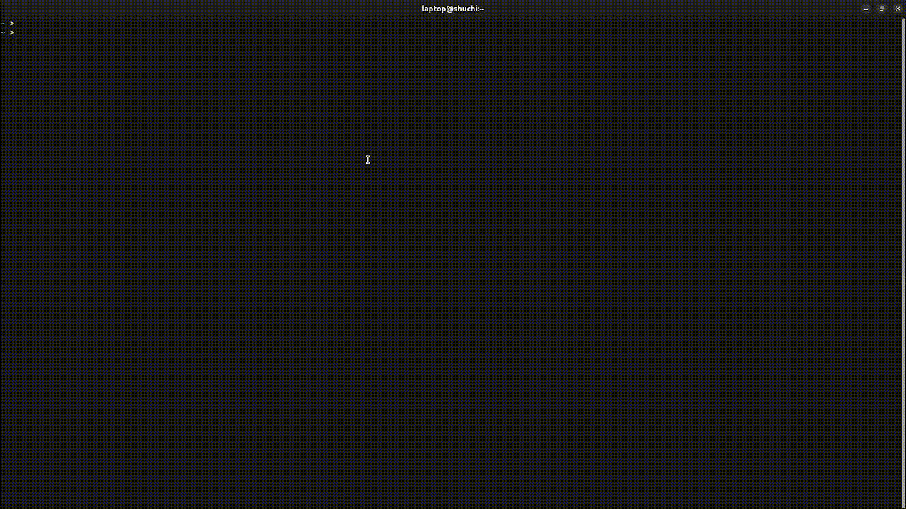

# Turning Linux Into Home

A virtual home which always makes me comfortable to code. There are different
shell scripts around here and each is responsible for installing packages and
completing a setup.

**Setup:** To setup given any of the utility, simply run `./setup-<name>.sh` and
if the utility is already installed, then one can use `./setup-<name>.sh -i` to
copy paste the configuration inside `~/.config/<utility>`.

## NEOVIM

Being a strong command line-based editor, NVIM creates comfortable environment
for programming without touching your mouse.

### 1. Keybindings

**NOTE:** `<leader>` is `Space`.

I've chosen to not go with NvChad's keybindings and rather use the ones which
I've made being inspired from VS Code keybindings. Use `<leader>+ch` to see
complete set of keybindings.

### 2. Display

Here is how it looks so far :-)

## TERMINATOR

A terminal with the Bright Lights theme is installed under this setup. The
config and the TerminatorThemes plugin live in `terminator/`.

## ZSH

Replaces bash with zsh, starting from installation to complete configuration
setup, this creates a smooth working environment on any terminal/terminator.

## VS CODE

VS Code is installed from Microsoft's apt repository along with the extensions,
and the formatters that the settings point at. The settings, keybindings and
`argv.json` live in `vscode/` and are copied into`~/.config/Code/User`.

## WIDGETS

Conky widgets on the built-in display (clock with date, and the day name) and
the Dash to Panel bottom dock on every monitor. The conky configs, their
launcher, its autostart entry, the Josefin Sans font and the Dash to Panel
settings live in `home/`. The launcher restarts conky whenever a monitor is
plugged in or removed, so the widgets keep their size and place under
fractional scaling. It also turns the amdgpu TearFree option on for every
monitor, since the scaled built-in display forces a software cursor that
otherwise flickers on the external one. The Anurati font is free for personal use only, so it is
not kept here; download it into `~/.local/share/fonts`.
